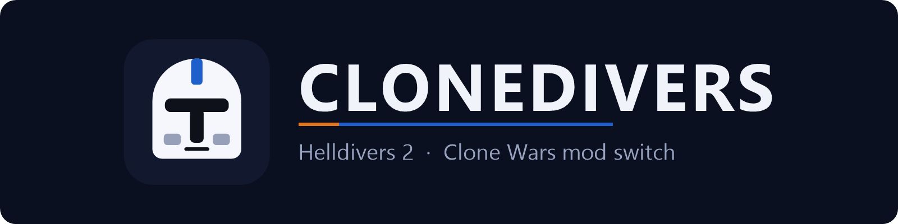

# Clonedivers — Forge

Choose **Regular**, **Clones** or **Empire** in a separate HellForge installation.
Play the official online Helldivers 2 game directly through Steam.

[Windows launcher](https://github.com/owendavidgoode/clonedivers/releases/latest/download/Clonedivers.exe) · [Ubuntu/Debian x86-64 package](https://github.com/owendavidgoode/clonedivers/releases/download/linux-v0.6.1/Clonedivers-linux-x64.deb) · [Linux portable](https://github.com/owendavidgoode/clonedivers/releases/download/linux-v0.6.1/Clonedivers-linux-x64.tar.gz)

## Update or install

Existing Windows launchers receive **1.11.0** through their normal launcher-update
button. Existing Linux launchers show the **0.6.1** release; install its complete
.deb or extract the full portable archive. Linux updates require a package-manager
or manual installation; a notice does not silently replace the old application.

Read [the migration and first-setup guide](docs/FORGE-MIGRATION.md). The launcher
update preserves settings and account data and keeps a verified previous Windows
executable for rollback. It does not edit live Steam game files, close a running
game or install the gameplay dependencies automatically.

Every player needs their own Steam-owned HD2, official separate **HellForge
0.3.0-beta / engine 0.1.41 / SDK15 / game25480438**, and permitted matching mods.
Keep supported isolation and sandbox enabled. Linux requires a dedicated Proton
prefix and the official namespace setup. Complete Linux packages include the
native UI, Windows bridge and pinned GPL source scripts; no separate .NET install
is needed. ARM64, Deck and Flatpak/Snap Forge are not qualified.

## Modes, account and gameplay

Regular, Clones and Empire are Forge appearance choices. Delta armor, CIS droids,
Covenant squids and texture options remain available. Every mode uses the player's
own verified **one-way HD2 → Forge account import**. Forge progression saves
locally and does not count back in official HD2. Never share captures, profiles,
receipts or keys or replay stale captures to test persistence.

The scale-up baseline combines D11, Heavy SEAF + Squad Stratagems, native Smarter
SEAF, smarter dogs/sentries, reroller and supporting mods. [Coverage, dependencies
and author sources](docs/FORGE-MOD-COVERAGE.md) distinguish installed, optional,
conflicting and gated candidates. The download contains **no third-party mod
archives or private Heavy/Squad repairs**. Reproducible permitted onboarding for
new peers remains open. Missing dependencies block launch rather than silently
changing the experience. Disable official host mod sharing when using private
adaptations; each peer needs permitted matching artifacts.

## Test status

The owner has played solo D11 with working SEAF drops. Windows source/session
checks, native/bridge fixtures and Linux package installation/help checks are
recorded in the [Forge setup/status](docs/FORGE.md) and CI. These do not certify
Linux Proton gameplay, account capture, mission reward persistence or multiplayer.
Use the [separate-PC squad checklist](docs/HELLFORGE-SQUAD-ACCEPTANCE.md) for joins,
drops, extraction and reconnect tests. Native Quit hanging and ship distortion
remain open; use **End session** for official cleanup.

## Steam cleanup and recovery

Updating the launcher does not remove previously enabled Clonedivers mods from
Steam. Follow the one-time cleanup section in the migration guide before treating
Steam as vanilla. Retained old launchers and explicit `--steam` mode are recovery
tools. The default application is Forge. [Legacy Linux notes](docs/LEGACY-LINUX.md)
are retained for recovery, not the current installation path.

## Development and license

Build with .NET8. Fetch the pinned PresentMon input using tools/fetch-presentmon.ps1
for Windows, then run Clonedivers.Tests. Forge is the Linux build default;
`-p:ForgeEdition=false` is only for legacy recovery tests. The Forge package
workflow builds complete assets and checks them on Ubuntu22.04/24.04/26.04. It
never packages accounts, game files or restricted gameplay mods.

[MIT](LICENSE) for the launcher and original mine-boundary source. Community mods
belong to their credited authors. Pinned HellForge Linux scripts retain GPL-3.0
source/COPYING and a documented lifetime-only adaptation. PresentMon and native
runtime licenses accompany their distributions. Fan utility, not affiliated with
Arrowhead/Sony or Lucasfilm.
