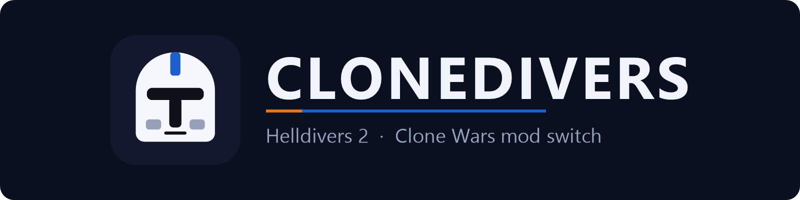

# Clonedivers — Forge

Choose **Regular**, **Clones** or **Empire** in a separate HellForge installation.
Play the official online Helldivers 2 game directly through Steam.

[Windows launcher](https://github.com/owendavidgoode/clonedivers/releases/latest/download/Clonedivers.exe) · [Ubuntu/Debian x86-64 package](https://github.com/owendavidgoode/clonedivers/releases/download/linux-v0.10.4/Clonedivers-linux-x64.deb) · [Linux portable](https://github.com/owendavidgoode/clonedivers/releases/download/linux-v0.10.4/Clonedivers-linux-x64.tar.gz)

## Quick Start for Friends (Windows)

1. **Download and run `Clonedivers.exe`** — because the launcher is self-published, Windows Defender SmartScreen may show **"Windows protected your PC"**. Click **More info** -> **Run anyway**.
2. **Keep Helldivers 2 installed and updated in Steam** — Clonedivers uses your Steam ownership and HD2 install for Forge's game copy and mandatory account sync. Official online HD2 stays untouched in Steam.
3. **Allow ~70 GB free space** on a local folder outside OneDrive and Steam (for example `D:\HellForge`).
4. **Pick your mode & visuals first**: choose **Regular**, **Clones**, or **Empire**, plus **Texture Quality** (`Full (Ultra)`, `High (Streamed)`, `1024px (Medium)`, `512px (Low / Deck)`, or `256px + Decimated Meshes (Ultra-Potato)` — cutting mission Dedicated VRAM by `-51.8%` in live benchmarks and pack disk up to `-66%`). New installs default to **Full Star Wars Mix** (`Mixed Bots + CIS` and `Mixed Covenant + Squids`); enemy skins, Delta Squad, and Imperial Encrypted Death Trooper voice are under **Customize -> Advanced**.
5. **Follow the 4-step Setup Wizard**:
   - **Step 1 · Preflight Check**: confirms Steam is signed in and 70 GB is free.
   - **Step 2 · Forge & Game Copy**: sign in with the **Steam Mobile App QR scanner**, or click **Official setup (fallback)** if you don't have the phone app. Windows will ask for administrator (UAC) approval two or three times.
   - **Step 3 · Guided Steam Account Sync (Required)**: required once before your first Forge launch so your real HD2 warbonds, unlocks, and progression copy locally. Leave *Apply import* and *auto-apply* off — Clonedivers imports the sealed capture automatically when HD2 and HellForge close. *(Never share your account capture files with anyone else.)*
   - **Step 4 · Pack Download & Ready**: downloads the gameplay preset and selected Star Wars pack with byte progress, then returns to **Ready to launch**.
6. **First launch firewall prompt**: click **Allow access** if Windows asks for network approval on your first launch.

## Update or Install

The current releases are **Windows 2.1.4** ([v2.1.4](docs/releases/v2.1.4.md)) and **Linux Forge 0.10.4** ([linux-v0.10.4](docs/releases/linux-v0.10.4.md)), shipping **5 native texture tiers** across **EmpireDivers `2026.11.25-r52`** (front-Armory helmet, armor, UV, and MRA repairs across `447` `UNIT`s including `RE-1861` ISB Kepi+Visor, `A-9`/`A-35`/`TG-122` Katarn, `TG-8`/`FS-23` Crimson Dagger, `GS-11` AT-AT Driver, `EX-16` Arc-Shield, `FS-37` Fire Trooper, `B-27` glowing K-2SO optics, and `CM-09` Compact LEGO; `591` Whisper-verified SEAF-free Imperial comms streams + `20,306` SEAF-free US English strings across all `14` `TEXT` tables; `9.04 m` *Jedi: Fallen Order* AT-ST walkers across `EXO-45/49/51/55`; and deduplicated `<64`-bone Lambda/SEAF/dropship rigs) and **Clonedivers `2026.11.25-r23`** (`85` repaired Clone & Delta Squad `UNIT`s including `B-01` 501st Phase II, `Delta-38` Boss Katarn, `CM-09` Sev/212th, `CW-4`, `DS-10`, `FS-05`, `RS-89`, and 501st `cha_seaf` NPCs; 100% SEAF-free Grand Army of the Republic comms & strings; and CIS *Providence* Dreadnoughts vs Republic *Venators* orbital skybox), **3-way Covenant + Squids mix**, and **`build25480438-r11`** (`18` verified archives, `8,518,467` B, `0` `hf-mod.com` URLs, upgrading **`clean-exit 0.2.1`** and **`starwars-localization 0.1.1`**). Update Windows through the launcher. On Linux, install the complete `.deb` or extract the full portable archive.

New players press **Set up Clonedivers** on Windows or **Set up / update Forge**
on Linux. Windows checks for at least **70 GB** (`70 GiB`) free on the Forge
drive before installing or upgrading the verified Forge application, copies build
`25480438` from Steam or downloads it via Steam Guard QR approval, guides mandatory
one-way Steam account sync, and installs the gameplay preset and selected appearance.
Linux downloads and opens the official native installer and offers Ubuntu/Debian tool
installation (`passt` / `pasta` required). Steam sign-in and system approval remain
player actions. Existing Windows Forge `0.3.0-beta` installations offer **Update
HellForge** with protected-state checks and verified application rollback.

Read [the migration and first-setup guide](docs/FORGE-MIGRATION.md). The launcher
update preserves settings and account data and keeps a verified previous Windows
executable for rollback. It does not edit live Steam game files or close a running
game. **Set up selected mode** obtains **18 gameplay downloads** automatically in
the `build25480438-r11` catalog (**9 required** gameplay and author archives totaling
`7,991,821` bytes / `~7.62 MiB` including host-gated `Faster Corpse Cleanup` `1.0.6-clonedivers.1` and `Heavy SEAF` `1.2.0-clonedivers.5`, plus **9 optional** project-owned SDK-16 defaults totaling `526,646` bytes: `Clonedivers Clean Exit` `0.2.1`, `LEGO Compact Leaf Writer` `0.2.2`, `Empire LEGO Yoda Death` `0.2.1`, `Empire AT-ST Film-Scale Leaf Writer` `0.2.3`, `Empire per-attack TIE` `0.3.0`, O(1) `Empire & Clone Camera Pullback` `0.1.4`, `Star Wars Localization Bridge` `0.1.1`, co-op `Dedicated Melee Slot` `1.5.2-clonedivers.2`, and co-op/Mission-2 hardened `Chaos Invasions` `0.3.5`), totaling **`8,518,467` bytes (`~8.12 MiB`)** before appearance assets. It verifies their
archives and content, imports them through Forge, applies preset order/options and
then prepares the appearance.

The **3** official bundled mods plus those **18** downloads (`9` required + `9` optional
defaults enabled on fresh `r11` setup, with enabled `r4`–`r10` defaults upgraded
automatically while preserving any optionals a player disabled or removed) and **1**
selected appearance pack form the complete **22-mod** Clones or Empire setup (`21`
active mods in Regular). Following the **19 November 2026** `hf-mod.com` shutdown,
`build25480438-r11` uses **zero `hf-mod.com` URLs**: permissive `0BSD` / `MIT`
mirrors (`Vanilla Plus Megapack 0.2.1`, `Operation Reroller 0.1.6`, `Shared Callback
Manager 0.1.0`, `Faster Corpse Cleanup 1.0.6-clonedivers.1`, `Dedicated Melee Slot
1.5.2-clonedivers.2`) and owner-permitted MP-hardened SEAF packages (`Heavy SEAF
1.2.0-clonedivers.5`, `SEAF Squad 0.1.4-clonedivers.3`) come from pinned GitHub
Releases, while `Bingus Shared Loader v20`, `Smarter SEAF 1.0.4`, and `Smarter Guard
Dogs & Sentries 5.2.0` download directly from their authors' GitHub Releases (`All
rights reserved` Th3chef archives are never mirrored). Retired legacy mods
(`local.clonedivers-mine-boundary`, `chef.smarter-seaf`, standalone `Mod Options Menu
v1.2.1`, and `Reinforcement Beacons Fixed 4.6.1`) are disabled automatically. See
[sources and permission scope](docs/SEAF-COMPATIBILITY-PERMISSION.md). Setup turns
automatic host mod sharing OFF and guides your own HD2 account import.

Every player needs their own Steam-owned HD2, official separate **HellForge
0.4.0-beta / engine 0.1.47 / SDK 16 / game 25480438**, and permitted matching mods.
Keep supported isolation and sandbox enabled. Linux requires a dedicated Proton
prefix and the official namespace setup (`pasta` from `passt` on Ubuntu 24.04+ /
Debian 13+ or equivalent). Complete Linux packages include the native UI (`0.10.4`)
and controller (`0.4.0`); no separate .NET install is needed. ARM64, Steam Deck, and
Flatpak/Snap Forge are not qualified.

## Modes, Account, and Gameplay

Regular, Clones and Empire are Forge appearance choices. In **2.1.4** / **0.10.4**,
both **Clones (`2026.11.25-r23`)** and **Empire (`2026.11.25-r52`)** ship the full
**5-tier texture matrix** (`Full (Ultra)`, `High (Streamed)`, `1024px (Medium)`,
`512px (Low / Deck)`, and `256px + Decimated Meshes (Ultra-Potato)` — cutting mission
Dedicated VRAM by `-51.8%` in live benchmarks and pack disk up to `-66%`), **3 Enemy Skins** (`All CIS Droids`,
`Mixed Bots + CIS Droids`, `Native Automatons`), and **3-way Covenant + Squids**
(`Mixed Covenant + Squids` default, `All Covenant`, `Native Squids`), plus **Delta Squad**
in Clones and opt-in **Encrypted Death Trooper Voice** (OFF by default) in Empire.
See [v2.1.4 release notes](docs/releases/v2.1.4.md), [linux-v0.10.4 notes](docs/releases/linux-v0.10.4.md),
and [JohnsonMode notes](docs/JOHNSONMODE.md). Every mode uses
the player's own verified **one-way HD2 → Forge account import**. Forge progression
saves locally and does not count back in official HD2. Never share captures, profiles,
receipts or keys or replay stale captures to test persistence.

The scale-up baseline combines D11, MP-hardened Heavy SEAF `1.2.0-clonedivers.5` + Squad
Stratagems `0.1.4-clonedivers.3`, Smarter SEAF `1.0.4`, Smarter Guard Dogs & Sentries
`5.2.0`, host-gated Operation Reroller `0.1.6` & Faster Corpse Cleanup `1.0.6-clonedivers.1`,
Shared Callback Manager `0.1.0`, and Vanilla Plus Megapack `0.2.1`. [Coverage, dependencies
and author sources](docs/FORGE-MOD-COVERAGE.md) distinguish installed, optional,
conflicting and gated candidates. The download contains **no third-party mod
archives**; setup obtains the complete pinned preset automatically, including
the permission-cleared Heavy/Squad repairs. Missing dependencies block launch
rather than silently changing the experience. Each peer runs setup to obtain
matching artifacts; automatic host sharing stays OFF.

## Test Status

For **v2.1.4 (`2.1.4` / `0.10.4`)**, static and offline verification passed across all
three `.NET 8` Release `-warnaserror` builds and test suites (`Clonedivers.Tests`,
`Clonedivers.Linux.Tests` `230/230`, `Clonedivers.ForgeBridge.Tests` `319/319`),
`tools/forge-lab` (`unittest discover` OK), all `12/12` `verify_candidate.py` pack
scenarios (`VERIFIER_EXIT=0` across `437` soundbanks, `8,362`–`8,684` native stream
wrappers, `0` duplicate keys/codec mismatches/missing dependencies, and `100%` `unit_safe`
`<= 64`-bone rigs), SHA-256 verification of all `293` `v24` delta blobs (`9,791,027,236` B),
and all `9` SDK-16 C11/Lua code-mod suites (`clean-exit 0.2.1` `16/16` modes,
`starwars-localization 0.1.1` `56/56` checks across `14` US `TEXT` tables / `20,306`
strings at `0` SEAF leaks, `empire-atst-writer 0.2.3` `ATST_TIER0_SUMMARY: ALL_PASS` +
`180 Mcalls/s` 16T stress, `lego-compact-leaf-writer 0.2.2`, `empire-camera-pullback
0.1.4`, `chaos-invasions 0.3.5`, `empire-lego-yoda 0.2.1`, `empire-tie-switch 0.3.0`
`parts=135`, and `dedicated-melee-slot 1.5.2-clonedivers.2` `97` C11 + `34` Lua checks).

Played-through Windows Direct3D verification on `D:\HellForge` passed across **10 fresh
`helldivers2.exe` processes** (`0` crashes, `0` `.dmp` files):
- **Multi-mission Empire `r52` & Clones `r23` gameplay:** Verified front-lit `yaw=176`
  Armory captures (`12` Empire + `10` Clones + `4` `commandos` Delta Squad kits), live
  SEAF-free Imperial & GAR subtitles and Armory names (`starwars-localization 0.1.1`:
  `1,187` Clone / `1,156` Empire active overrides, `0` SEAF leaks, `Forge Credits`
  intact), simultaneous `EXO-49` + `EXO-45` `9.04 m` AT-ST walkers (`walkers=2`,
  `88,268` substitutions, `leaf_fail=0`, `ret=2`), Republic AT-TE + 501st SEAF Clone
  Squad + Extraction Lambda & LAAT/i landings (`rc=0`), Compact LEGO (`1.28M+` Empire
  and `223k+` Clone frames, `failed=0`) + local Yoda death screams, Mission 1 -> Leave ->
  Mission 2 `chaos-invasions 0.3.5` `rearms=3` + completed foreign waves across all 3
  factions, and live `clean-exit 0.2.1` `WM_CLOSE` clean exits both mid-mission
  (`+0x626296` fault caught -> `TerminateProcess(0)`, `exitCode=0`) and on the Ship
  (`3,000 ms` watchdog -> `TerminateProcess(0)`, `exitCode=0`).
- **Low-VRAM `potato256` & 6-process Difficulty-10 `PresentMon 2.5.1` ABBA benchmark
  (`1280x720`, `Planet 157`, active walker + SEAF + Chaos, `2` fresh processes per arm):**
  - `Regular r11`: **`82.38` FPS** D10 mission median (`[79.53, 85.23]`, spread `5.70`),
    `36.99` FPS 1% low, `27.41 ms` `p99`, **`4.29 GiB`** mission Dedicated VRAM (`0`
    Star Wars localization hooks).
  - `Clones r23 Full`: **`72.63` FPS** D10 mission median (`[77.14, 68.13]`, spread
    `9.01`), `35.45` FPS 1% low, `28.25 ms` `p99`, **`16.20 GiB`** mission Dedicated VRAM.
  - `Empire r52 Full`: **`66.32` FPS** D10 mission median (`[70.46, 62.19]`, spread
    `8.27`), `33.93` FPS 1% low, `29.63 ms` `p99`, **`16.23 GiB`** mission Dedicated VRAM.
  - `Empire r52 potato256`: **`7.83 GiB`** mission Dedicated VRAM (`8.98 GiB` peak,
    **`-51.8%`** vs `Full`), **`0.30 GiB`** Shared GPU (`-94.7%`), **`8.45 GiB`** Working
    Set (`-41.8%`), with active `9.04 m` AT-ST (`subs=17,740`, `leaf_fail=0`). Note:
    `empire-tie-switch 0.3.0` pins `Full` / `High` / `512px` hashes and fails closed
    safely on `1024px` and `256px` (retaining the base TIE Fighter Eagle-1).

See [Forge setup and status](docs/FORGE.md) and [STATUS.md](docs/STATUS.md). Separate-PC
human co-op sessions ([squad checklist](docs/HELLFORGE-SQUAD-ACCEPTANCE.md)), native
Linux Proton gameplay (CI verifies Ubuntu `22.04`/`24.04`/`26.04` `.deb`/portable upgrades
and `xvfb` GUI startup), manual player keybind throws for Eagle TIE sorties, and
low-VRAM physical GPU testing remain open outside single-PC Windows Direct3D runs.

## Steam Cleanup and Recovery

Updating the launcher does not remove previously enabled Clonedivers mods from
Steam. Follow the one-time cleanup section in the migration guide before treating
Steam as vanilla. Retained old launchers and explicit `--steam` mode are recovery
tools. The default application is Forge. [Legacy Linux notes](docs/LEGACY-LINUX.md)
are retained for recovery, not the current installation path.

## Development and License

Build with .NET 8. Fetch the pinned PresentMon input using `tools/fetch-presentmon.ps1`
for Windows, then run `Clonedivers.Tests`. Forge is the Linux build default;
`-p:ForgeEdition=false` is only for legacy recovery tests. The Forge package
workflow builds complete assets and checks them on Ubuntu 22.04/24.04/26.04. It
never packages accounts, game files or restricted gameplay mods.

[MIT](LICENSE) for the launcher and original mine-boundary source. Community mods
belong to their credited authors. The official HellForge installer retains its
own upstream licensing. PresentMon and native
runtime licenses accompany their distributions. Fan utility, not affiliated with
Arrowhead/Sony or Lucasfilm.
